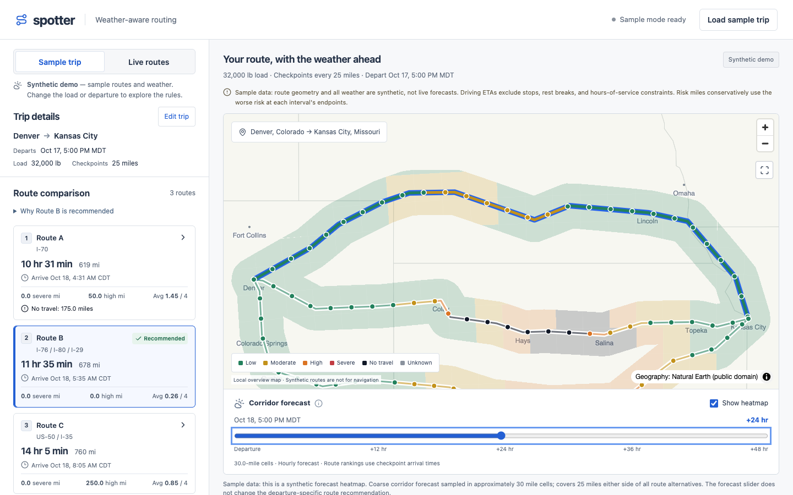

# Spotter

Compare truck routes using the weather expected **when the truck reaches each checkpoint**.
React + TypeScript on the frontend, Django on the backend. The interface puts the trip form,
route comparison, map, and forecast timeline in one workspace.

**[Open the hosted application](https://spotter-web-swart.vercel.app)** ·
**[GitHub repository](https://github.com/thriftykapila/spotter)**

The hosted app supports live US truck routing and a labeled sample trip. TomTom, Upstash Free,
and Vercel Hobby are configured. No payment method or paid upgrade was added during setup.



## Run locally

Requires Node 24 LTS, Python 3.13, and [uv](https://docs.astral.sh/uv/).

```bash
make install
make dev
```

Open http://127.0.0.1:5173. The clearly labeled synthetic Denver–Kansas City trip works without
API keys or Redis. Change load, departure, or checkpoint spacing to explore the rules.

For live routes, copy `backend/.env.example` to `backend/.env` and configure:

| Variable | Purpose |
| --- | --- |
| `TOMTOM_API_KEY` | Server-only truck routing and US geocoding |
| `UPSTASH_REDIS_REST_URL` | Shared forecast/trip cache and quota coordination |
| `UPSTASH_REDIS_REST_TOKEN` | Server-only Redis access |
| `DJANGO_SECRET_KEY` | Random signing secret; required on Vercel |

An optional, separate, restricted `VITE_TOMTOM_MAP_KEY` in `frontend/.env` enables TomTom base
tiles. Never put the routing or Redis key in a `VITE_` variable. Live requests stay unavailable
when their configuration or shared quota coordination is missing; they never become sample data.

## How routes are assessed

1. TomTom Routing v1 is asked for a truck route and two alternatives. Fewer distinct options
   may be available; the interface shows the actual count.
2. Checkpoints include the origin, every 10/25/50 miles, and the destination. Their ETAs use
   cumulative routing progress rather than one average speed for the whole trip.
3. Open-Meteo forecasts are matched to each checkpoint's arrival time. Rain includes rain
   plus showers. Fresh snowfall, sustained wind, and gusts have distinct meanings.
4. The highest hazard risk applies at each checkpoint. An interval receives the maximum risk
   of its endpoints, and its distance contributes to that risk band's miles.
5. Routes with No Travel conditions or missing weather are excluded. Remaining options are
   ordered by Severe miles, High miles, distance-weighted average risk, and travel time.

These are weather assessments under the supplied rules, not a guarantee of safe passage.
Payload is used for weather scoring; a vehicle-specific height, axle, and gross-weight profile
is not configured. ETAs exclude breaks. Gusts are displayed separately from the sustained-wind rules.

The corridor forecast uses a separate grid extending 25 miles either side of the routes. At most
200 cells are shown, with resolution disclosed. The 0–48 hour slider is anchored to departure;
it explores forecast time without changing arrival-time route scoring. It makes no network requests
while scrubbing.

See [risk assumptions](docs/risk.md), [API contract](docs/api-contract.md), and
[interface decisions](docs/design.md).

## Checks

```bash
make test
make build
make lint
```

Browser scenarios live in `frontend/e2e/` and run with `npm run test:e2e` from `frontend/`.
GitHub Actions runs backend tests, native dependency imports, frontend tests, and the production build.
See the [verification record](docs/verification.md) for live-trip results and measured limits.

## Hosting

Two Vercel projects share this repository: the frontend at root `frontend/`, and the API at root
`backend/`. A same-origin frontend rewrite forwards `/api/*` to the backend. Upstash Free stores
temporary analyses and forecasts, not user accounts or trip history.

[Deployment instructions](docs/deployment.md) cover secrets, API rewrites, preview verification,
and free-tier limits. [Walkthrough script](docs/walkthrough.md) provides a seven-minute recording
sequence. No Loom recording is included yet.

Live requests stop if shared quotas or Redis are unavailable. Upstash Free exhaustion can pause
live service; the sample trip remains usable. Paid plans must be selected manually outside the app.

## Data sources

- [TomTom Routing v1](https://docs.tomtom.com/routing-api/documentation/tomtom-maps/v1/calculate-route)
- [Open-Meteo forecast documentation](https://open-meteo.com/en/docs)
- [TomTom pricing](https://docs.tomtom.com/pricing)
- [Open-Meteo terms](https://open-meteo.com/en/terms)
- [Natural Earth public-domain geography](https://www.naturalearthdata.com/about/terms-of-use/)

The credential-free sample contains synthetic route geometry and synthetic weather. It is intended
for reproducible review, not driving directions. Provider/map attribution is retained in the app.
Live weather uses Open-Meteo's noncommercial evaluation service; commercial use needs an appropriate plan.

The keyless overview map bundles Natural Earth land and state boundaries with a small local city
label set. No external basemap request is needed for the sample. It does not contain street-level
navigation detail; a separate restricted map-display key enables the TomTom street basemap.
